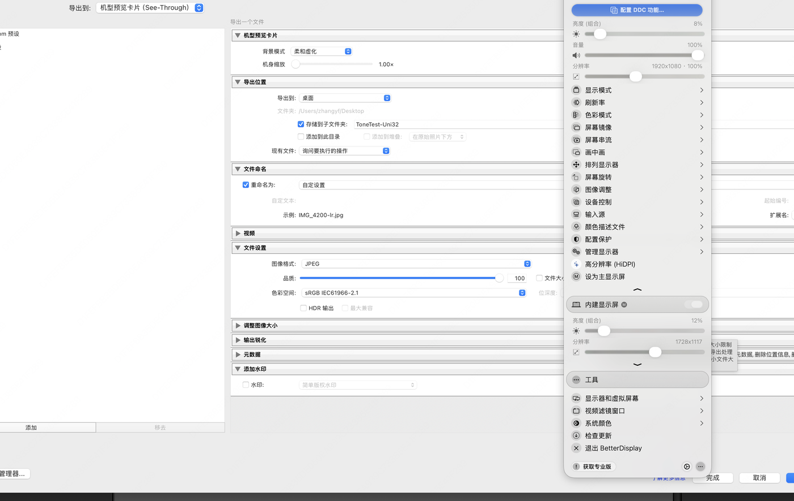
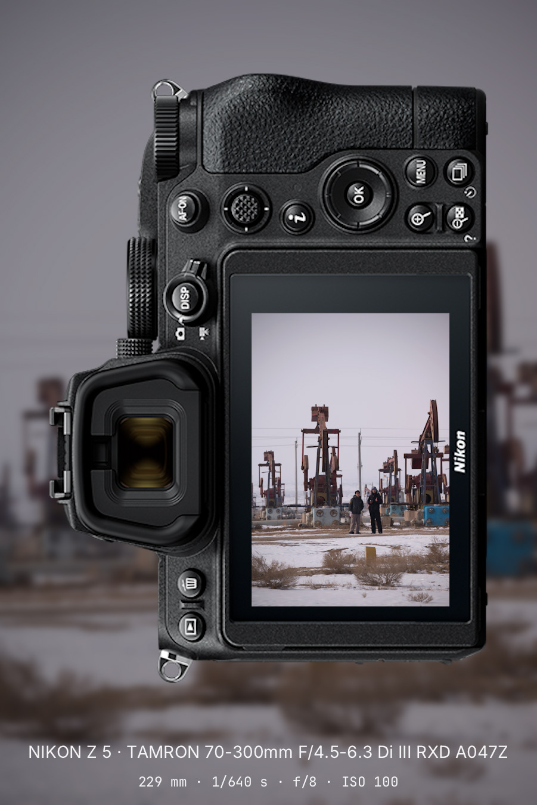
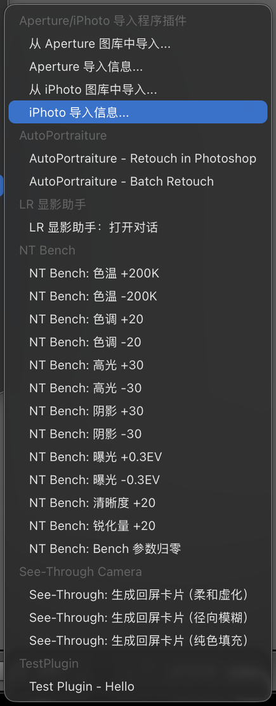

# See-Through Camera — Lightroom Classic plugin

[中文版说明 →](README.zh-CN.md)

A Lightroom Classic plugin that turns the selected photo into a
"see-through camera" card: the photo appears on the camera body's LCD
screen, with blurred background, and a caption line with model / lens /
exposure. The actual rendering is done by the
[see-through-camera](https://github.com/AaronyfDesign/see-through-camera)
CLI; this plugin provides the in-Lightroom experience.

## How it works

```
menu click → selected photo → full-resolution JPEG export (keeps EXIF)
           → external CLI render (--body auto --bg <mode>) → reveal in Finder
```

- The export step is the standard Lightroom pipeline, so the CLI receives a
  real JPEG with full EXIF and resolves the body profile itself (`--body
  auto` matches `body_profiles/*/profile.json` aliases). No per-model table
  is maintained in the plugin.
- Three background modes are exposed as separate menu items under
  **File → Plugin Extras** (see "Menu entries" below): soft blur /
  radial blur / solid fill.

## Export integration

The plugin also hooks into Lightroom's standard export flow: in
**File → Export…**, pick **See-Through camera card
(机型预览卡片（See-Through）)** in the "Export To" dropdown.



The panel offers:

- **背景模式** (background mode): soft blur / radial blur / solid fill.
- **机身缩放** (body scale): 1.00×–1.50× slider. The body and the embedded
  photo scale together as one unit. Per-model caps apply: Nikon Z 9 tops
  out at 1.28×, other models at 1.50×; rendering additionally clamps so
  the body never leaves the canvas or covers the caption line.

Rendered cards are saved **next to Lightroom's own export destination** —
the folder chosen in the export dialog's "Export Location" section — and
revealed in Finder when the export finishes. (Logs and intermediate files
stay in the plugin's `output/` folder.) In-app menu titles follow the
Lightroom UI language; the Chinese labels shown here are from a zh-CN UI.

The result of a 1.50× export:



## Menu entries

Single-photo quick generation is also available under
**File → Plugin Extras → See-Through Camera** — one menu item per
background mode. Cards land in the plugin's `output/` folder and are
revealed in Finder.



## Supported bodies

Kept in sync with `body_profiles/` of
[see-through-camera](https://github.com/AaronyfDesign/see-through-camera)
(EXIF model names and the matching profile):

| Body | Profile |
| --- | --- |
| Nikon Z 6III (NIKON Z6_3) | `z63` |
| Nikon ZR | `zr` |
| Nikon Z 5II / Z 5II C | `z52` / `z5iic` |
| Nikon Z 6 / Z 6II | `z6` / `z62` |
| Nikon Z 7 / Z 7II | `z7` / `z72` |
| Nikon Z 8 / Z 9 | `z8` / `z9` |
| Nikon Z f / Z fc | `zf` / `zfc` |
| Nikon Z 5 / Z 30 / Z 50II | `z5` / `z30` / `z502` |
| Nikon D850 | `d850` |
| Sony α6400 (SONY ILCE-6400) | `a6400` |
| Sony α6700 (SONY ILCE-6700) | `a6700` |
| Sony α1 II (SONY ILCE-1M2) | `a1m2` |
| Sony α7C II (SONY ILCE-7CM2) | `a7c2` |
| Sony ZV-E10 | `zve10` |
| Canon EOS 5D Mark IV | `canon5d4` |
| Canon EOS R5 Mark II | `canonr5ii` |
| Hasselblad X2D 100C | `x2d` |
| Hasselblad X2D II 100C | `x2d2` |
| Ricoh GR IV | `gr4` |
| LEGO camera (easter egg) | `lego` |

Unknown models fall back to the `lego` body. Adding a body only requires
a new profile in the CLI repo — no plugin change needed.

## Requirements

- Lightroom Classic (developed and verified on 15.4.1; macOS arm64/x86_64 and Windows x64 supported)
- No Python needed: the Release ZIP bundles a self-contained native
  renderer (`cardgen`). Python 3 + Pillow is only required for the
  fallback path (installing from a clone without a C compiler build).

## Install

> **No dependencies for the Release ZIP path: the bundle ships the
> plugin plus a native renderer binary, the bundled fonts and every
> body profile. Download, unzip, run the installer - done.**
> The Python fallback (only for clone installs) still needs Python 3
> with Pillow (`python -m pip install Pillow`) and the
> see-through-camera repo. When troubleshooting, start with `debug.txt`
> and `cli.log` in the plugin's `output/` folder.

### macOS

**Option A (recommended): download the Release ZIP.** Grab
`SeeThroughCamera-macos.zip` from the
[Releases](https://github.com/AaronyfDesign/see-through-camera-lr/releases)
page, unzip, and run `install.sh` (Terminal: `sh install.sh`). The ZIP
bundles the plugin, the native `cardgen` binary and every body profile -
no Python, no repo cloning. The installer clears the macOS quarantine
flag on the bundled binary automatically.

> **About Gatekeeper / "CLI render failed" on macOS:** the bundled
> `cardgen` is an unsigned (ad-hoc) binary. If you install by dragging
> the plugin folder into Lightroom's Modules folder yourself — skipping
> `install.sh` — the quarantine flag from the browser download survives,
and newer macOS releases kill the binary on launch, which the plugin
reports as "CLI 渲染失败". Two ways out: run `install.sh` once (it
clears the flag), or clear it manually:
>
> ```sh
> xattr -dr com.apple.quarantine ~/Library/Application\ Support/Adobe/Lightroom/Modules/SeeThroughCamera.lrplugin/bin/cardgen
> ```
>
> Since the v0.3.7 fix the plugin also strips the flag automatically on
> every render, so this only affects older releases.

**Option B: install from a clone.** Clone this repo and the
see-through-camera repo (sibling directory is auto-detected), then run:

1. Run:

   ```sh
   scripts/install.sh
   ```

   The script prefers a native renderer (it builds `cardgen` from the
   see-through-camera checkout if no prebuilt binary is found), copies
   the binary, fonts and body profiles into the installed plugin folder,
   and generates a machine-specific `Config.lua`. If no compiler is
   available it falls back to the Python CLI (auto-detected `python3` +
   `watermark.py`).

   If your paths differ, override via environment variables:

   ```sh
   SEE_THROUGH_CAMERA_CARDGEN=/path/to/cardgen \
   SEE_THROUGH_CAMERA_CLI=/path/to/see-through-camera/cli/watermark.py \
   SEE_THROUGH_CAMERA_PYTHON=/path/to/python3 \
   scripts/install.sh
   ```

2. In Lightroom: select a photo → **File → Plugin Extras → See-Through:
   generate camera card (生成回屏卡片)**. The card opens in Finder when
   done.

### Windows

**Option A (recommended): download the Release ZIP and double-click.**
Grab `SeeThroughCamera-windows.zip` from the
[Releases](https://github.com/AaronyfDesign/see-through-camera-lr/releases)
page, unzip, and double-click **install.cmd**. The ZIP bundles the
plugin, the native `cardgen.exe` renderer and every body profile —
no Python, no repo cloning needed. You
can also drag the `SeeThroughCamera.lrplugin` folder onto the
install.cmd icon; both work the same. Restart Lightroom Classic when
done.

**Option B: install from a clone (Python fallback).** Clone this repo
and the see-through-camera repo, then run:

```powershell
powershell -ExecutionPolicy Bypass -File scripts\install.ps1
```

It copies the plugin into `%APPDATA%\Adobe\Lightroom\Modules\`
(Lightroom auto-loads plugins from there — no preference registration
needed) and generates `Config.lua` with your paths. Overrides are the
same environment variables (`SEE_THROUGH_CAMERA_CARDGEN`, `_CLI`, `_PYTHON`). Uninstall on Windows: delete the plugin
folder from `Modules`.

## Uninstall

```sh
scripts/uninstall.sh
```

## Output & diagnostics

Cards and intermediate files land in the plugin folder's `output/`
directory: `card_*.jpg` (result), `debug.txt` (plugin trace),
`cli.log` (renderer stderr). Delete them freely.

## Project layout

```
src/SeeThroughCamera.lrplugin/
  Info.lua            plugin manifest (declarative menu items + export service)
  Config.lua          local paths (python / cli) — generated by install.sh
  SeeThroughCard.lua  shared implementation (all three menu entries)
  ExportServiceProvider.lua  custom export destination "See-Through card"
  card_{soft,radial,solid}.lua  thin menu-entry shims
scripts/install.sh    copy into LR Modules + fix plugin-path preference
scripts/uninstall.sh  remove both
```

## Development notes (verified SDK facts)

These cost real debugging time — don't re-learn them:

- `LrPhoto:requestJpegThumbnail`'s callback receives the **JPEG bytes
  themselves** as its first argument, not a path; and the JPEG it produces
  carries **no EXIF at all** and comes in sensor orientation. That is why
  this plugin exports via `LrExportSession` instead (full resolution,
  correct EXIF/orientation for free).
- Metadata getters (`getFormattedMetadata`, `getRawMetadata`) yield
  internally: calling them inside `pcall` fails with "Yielding is not
  allowed within a C or metamethod call". Call them directly inside async
  tasks.
- `LrLogger` never produced output on this machine; the plugin logs via
  plain `io.open` to `output/debug.txt`.
- Camera model as reported by `cameraModel` (e.g. `NIKON Z6_3`) must match
  an entry in the CLI's `body_profiles/*/profile.json` `aliases`.
- Plugin menu items are declared in `Info.lua` (`LrLibraryMenuItems`); an
  `LrInitPlugin`-based approach did not register menus reliably.
- `LrDialogs` has no `showInFinder` (caused an error dialog after every
  successful render, see issue #1) — the correct API is
  `LrShell.revealInShell(path)`.
- Export destination only takes effect via the internal keys
  (`export_destinationType = 'specificFolder'` +
  `export_destinationPathPrefix`); the UI-preset `LR_export_*` keys are
  ignored by the session. `rendition:renderImage()` exists only in the
  export-provider context; the menu-item path must use
  `doExportOnCurrentTask()`.
